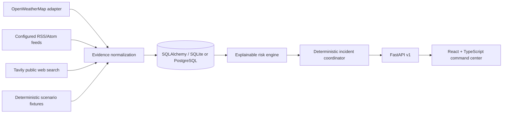

# PRALERT

PRALERT (Predictive Risk & Adaptive Local Emergency Response Technology) is a simulation-first disaster evidence and incident intelligence prototype focused on urban flooding in India. It correlates environmental observations and reports into auditable risk assessments. It is a decision-support prototype, not an official government service or certified warning authority.

## What is implemented

- FastAPI `/api/v1` backend with persistent SQLAlchemy storage (SQLite by default, PostgreSQL through `DATABASE_URL`).
- Explainable deterministic scoring (hazard intensity, verified official evidence, independent community corroboration, geographic relevance, freshness) and separate LOW/MEDIUM/HIGH evidence confidence.
- Three deterministic simulation fixtures, step/pause/resume/reset endpoints, synthetic provenance, incident/advisory persistence, and basic scenario assertions.
- Incident lifecycle actions, evidence/incident/settings/integration/analytics API routes, honest provider health, and configuration persistence.
- React/TypeScript command center, Leaflet/OpenStreetMap map, evidence/incident/agent/simulation/analytics/settings pages, responsive dark operations UI.
- Optional OpenWeatherMap, RSS/Atom, and Tavily collector adapters in `backend/app/collectors.py`. Keys remain server-side. Providers are never reported as successful when configuration or collection is absent.

## Architecture



## Run locally

Requirements: Python 3.11+, Node.js 20+, npm.

### Windows PowerShell

```powershell
python -m venv .venv
.\.venv\Scripts\Activate.ps1
python -m pip install -r backend\requirements.txt
Copy-Item .env.example .env
uvicorn app.main:app --app-dir backend --reload --port 8000
```

In another terminal:

```powershell
cd frontend
npm install
npm run dev
```

Open `http://localhost:5173`. API docs are at `http://localhost:8000/docs`. The database file is created as `pralert.db` in the working directory. To use PostgreSQL, start `docker compose up -d db` and set `DATABASE_URL=postgresql+psycopg://...` after installing a PostgreSQL driver.

macOS/Linux: use `python -m venv .venv && source .venv/bin/activate`, `python -m pip install -r backend/requirements.txt`, then `uvicorn app.main:app --app-dir backend --reload --port 8000`; from `frontend`, run `npm install && npm run dev`.

## Configuration

Copy `.env.example` to `.env`. `OPENWEATHER_API_KEY` enables the current-weather collector; `TAVILY_API_KEY` enables public web discovery; official feed URLs are passed to `collect_official()` by a caller. The UI keeps all integrations in explicit awaiting-configuration state until configured. No Twilio sender or LLM integration is wired into this prototype. No API key is needed for the synthetic simulator.

## API highlights

`GET /api/v1/health`, `/status`, `/agents`, `/evidence`, `/incidents`, `/analytics/overview`, `/settings`, `/integrations`, `/simulation/scenarios`, `/simulation/status`; incident lifecycle operations and simulation controls are under the same versioned prefix. Interactive OpenAPI docs are available at `/docs`.

## Tests

```powershell
python -m pytest
cd frontend
npm test
npm run build
```

Backend tests cover health, settings validation, simulation fixture/provenance behavior, provider degradation, and Pydantic validation. Frontend verification is currently limited to the strict TypeScript production build; add browser-level interaction tests before operational deployment.

## Risk model and limitations

Risk is a configurable engineering heuristic from 0–10; it is not a probability and has not been validated as a disaster forecast. Freshness decay discounts old observations, duplicate clusters are suppressed, and missing inputs are explicitly reported as missing rather than safe. Community search items stay unverified. The current application has no authentication, no migrations framework, no websocket stream, and no background scheduler; API refresh in the UI is polling-based. The feed collector currently does not deduplicate across database ingestion or infer expiry. Coordinates for incidents are not fabricated, so the map plots only the configured monitoring center until supported coordinates exist. Do not deploy for emergency response without domain review, authentication, threat modeling, calibrated labeled data, and operational safeguards.

Frontend configuration is optional. Copy frontend/.env.example to frontend/.env only if you want to change the API base URL. Backend settings are read from the process environment or root .env.
